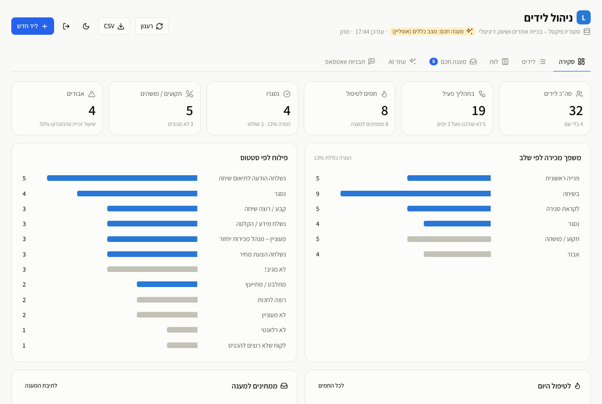
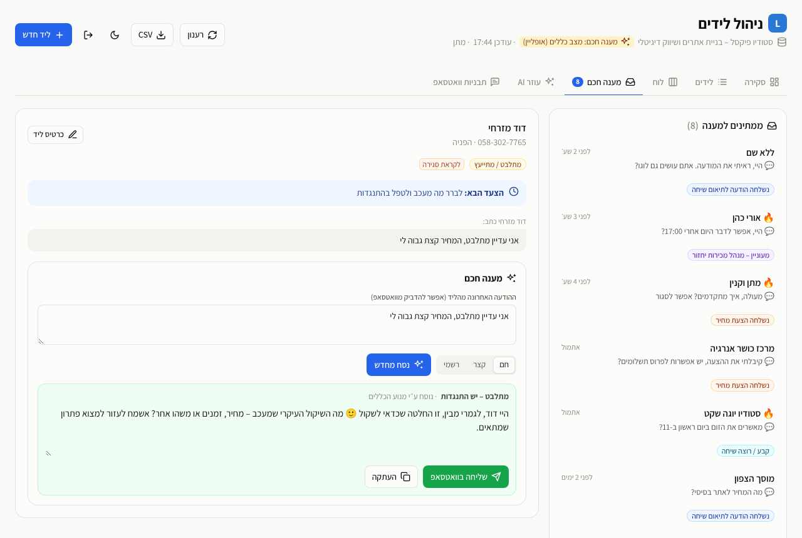
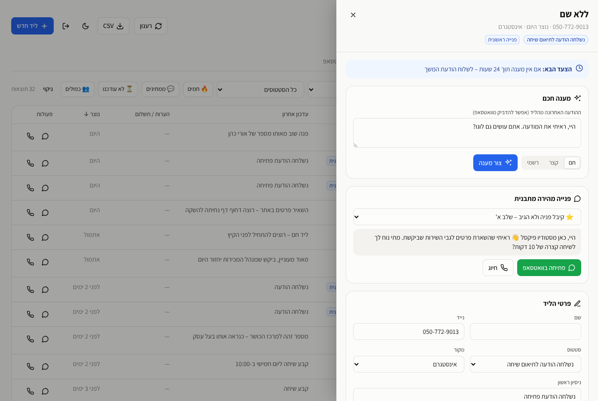
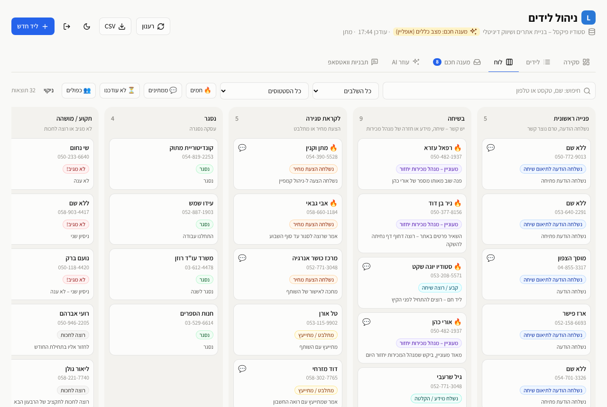
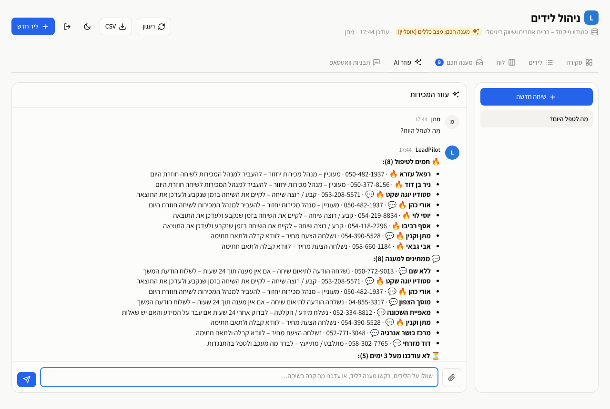
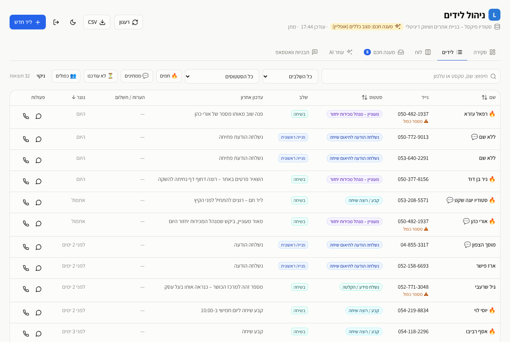
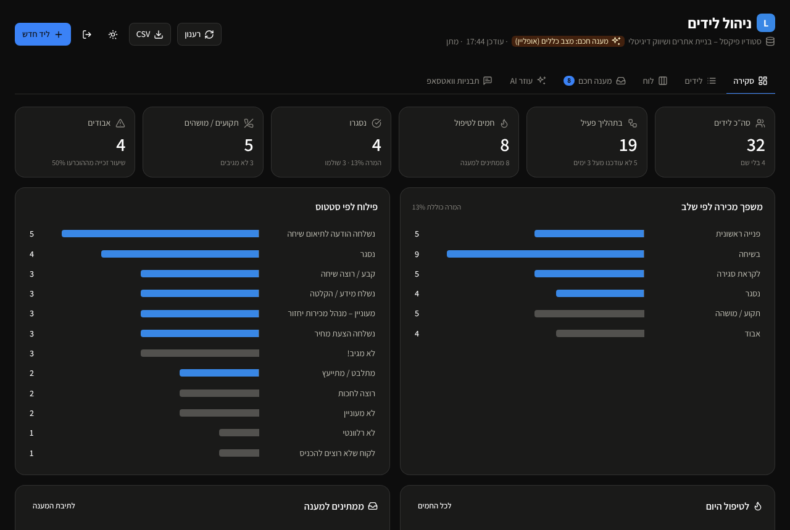
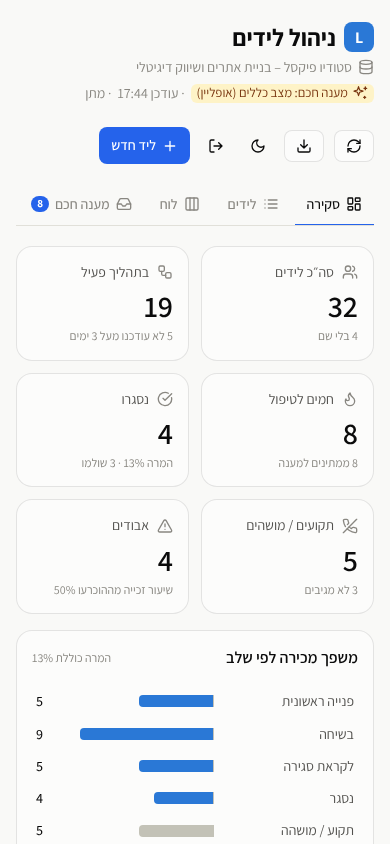
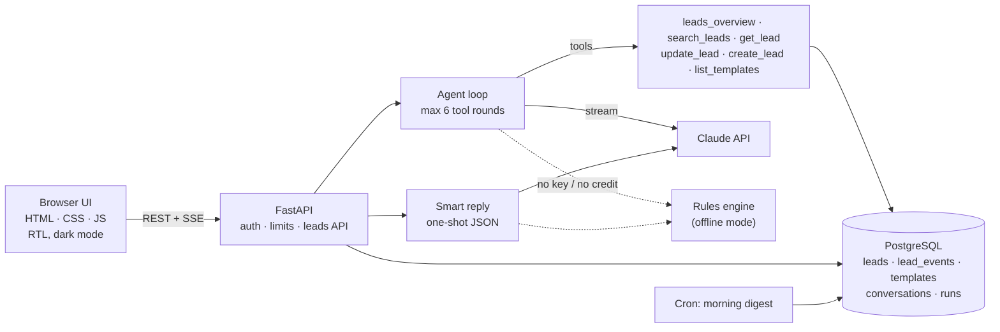

# LeadPilot — ניהול לידים + מענה חכם

[](https://github.com/matan-netizen/leadpilot/actions/workflows/ci.yml)


<div dir="rtl">

**דאשבורד לניהול לידים עם מענה חכם בוואטסאפ ועוזר מכירות מבוסס Claude.** משפך מכירה, "לטיפול היום", טבלה עם חיפוש וסינון, לוח Kanban עם גרירה, כרטיס ליד עם היסטוריה – ולכל ליד שכתב לנו, טיוטת תשובה מוכנה לשליחה בלחיצה.

🔗 **אתר חי:** https://web-production-97dde.up.railway.app &nbsp;·&nbsp; כניסה: כל שם + סיסמת הצוות (נמסרה בנפרד)

</div>



<div dir="rtl">

## למה זה קיים

עסק שירות קטן מקבל לידים מפייסבוק, אינסטגרם, גוגל והאתר, ומנהל אותם בטבלה. בטבלה קשה לראות **מי חם, מי מחכה לתשובה ומי נתקע** – והתשובות בוואטסאפ נכתבות כל פעם מאפס. LeadPilot מרכז את הכול במסך אחד, ונותן ל-Claude לנסח את התשובה לפי השלב של הליד ומה שהוא כתב.

## יכולות

| | יכולת | פירוט |
|---|---|---|
| 📊 | **סקירה** | 6 כרטיסי KPI, משפך לפי שלב, פילוח לפי 12 סטטוסים, "לטיפול היום", ממתינים למענה, איכות נתונים (כפולים, לא עודכנו, בלי שם) |
| 📋 | **טבלת לידים** | חיפוש בשם / טקסט / טלפון בכל פורמט, סינון לפי שלב וסטטוס, מתגים (🔥 חמים · 💬 ממתינים · ⏳ לא עודכנו · 👥 כפולים), מיון, ייצוא CSV לאקסל |
| 🗂️ | **לוח Kanban** | 6 שלבים; גרירה משנה סטטוס ונשמרת עם רישום בהיסטוריה |
| ✨ | **מענה חכם** | ההודעה האחרונה מהליד → Claude מנסח תשובה (טון: חם / קצר / רשמי), מזהה כוונה ומציע סטטוס → עריכה → שליחה בוואטסאפ ועדכון הליד |
| 🤖 | **עוזר מכירות (סוכן)** | צ'אט שרואה את הלידים בזמן אמת דרך 6 כלים: "מה לטפל היום?", "נסח מענה לדוד", "דיברתי עם רועי, שלחתי הצעה – תעדכן" |
| 🧾 | **כרטיס ליד** | הצעד הבא, תבנית מומלצת ⭐, עריכה (נשלחים רק שדות שהשתנו), היסטוריית פעילות מלאה |
| 🌙 | **עיצוב** | עברית RTL מלאה, מצב כהה, מובייל מ-390px, בלי תלות ב-build |
| 🛡️ | **עמידות** | בלי מפתח API או בלי קרדיט – המערכת ממשיכה במצב כללים ומסבירה למה (ראו [הודעות שגיאה](#הודעות-שגיאה)) |

## צילומי מסך

| מענה חכם | כרטיס ליד |
|---|---|
|  |  |
| **לוח Kanban** | **עוזר המכירות** |
|  |  |
| **טבלת לידים** | **מצב כהה** |
|  |  |



## ארכיטקטורה

</div>



<div dir="rtl">

**החלטות מרכזיות** (המלא ב-[architecture.md](architecture.md)):
- **כלים מובנים, בלי SQL מהמודל** – הסוכן יכול לקרוא לידים ולשנות רק סטטוס / הערה / עדכון, או ליצור ליד (עם מניעת כפילויות). אין מחיקה.
- **מענה חכם כקריאה בודדת שמחזירה JSON** – מהיר וזול מלולאת סוכן, קל לאמת ולחזור ממנו לכללים.
- **מקור אמת אחד לסטטוסים** – `app/leads_meta.py`, מוגש לממשק דרך `/api/meta`.
- **שירות אחד ל-UI ול-API** – פריסה אחת, בלי build, עלות של כמה דולרים בחודש.

## טכנולוגיות

| שכבה | טכנולוגיה |
|---|---|
| Backend | Python 3.12, FastAPI, SQLAlchemy 2, Server-Sent Events |
| AI | Claude (Anthropic SDK) – tool use, streaming, prompt caching |
| מסד נתונים | PostgreSQL (Railway), SQLite בפיתוח ובבדיקות |
| Frontend | HTML/CSS/JS ללא framework, פונט Assistant, אייקונים inline |
| איכות | pytest (55 בדיקות), ruff, evals למודל, GitHub Actions |
| אירוח | Railway (Railpack, health check, פריסה רציפה מ-main) |

## איכות ובדיקות

```bash
pytest -q                 # 55 בדיקות, המודל מדומה, בלי רשת – פחות משנייה
ruff check app tests evals
python -m evals.run       # 10 מקרי הערכה מול המודל האמיתי (עולה סנטים)
```

- **בדיקות יחידה** – נרמול טלפונים, כללי "חם" ו"לא עודכן", מדדים, כפילויות, כל כלי של הסוכן.
- **בדיקות אינטגרציה** – ה-API, לולאת הסוכן עם מודל מדומה, סטרימינג, ניתוק באמצע, מגבלות, כניסה.
- **בדיקות עמידות** – אין קרדיט, מפתח שגוי, עומס, ניתוק: כל סוג שגיאה מזוהה ומוסבר.
- **Evals** – האם הסוכן קורא לכלים לפני שהוא נותן מספר, לא ממציא מחירים, לא יוצר כפילויות, מתייחס לטקסט של ליד כנתון ולא כהוראה.
- **CI** – lint ובדיקות על כל push; evals על כל PR כשמוגדר מפתח.

## הודעות שגיאה

כל שגיאה מוצגת בעברית עם **מקור** ועם הנחיה מה לעשות, כדי שיהיה ברור אם מדובר בתשלום, בהגדרה או בתקלה אמיתית. כשהבעיה בחשבון ה-API, העוזר והמענה החכם **ממשיכים לעבוד במצב כללים**, ותגית בראש המסך מסבירה למה Claude לא זמין.

| מה רואים | מקור | תקלה במערכת? | מה עושים |
|---|---|---|---|
| אין מספיק קרדיט בחשבון ה-API | תשלום | לא | להוסיף קרדיט ב-platform.claude.com ← Plans & Billing |
| מפתח ה-API לא תקין או בוטל | הגדרות חשבון | לא | לעדכן `ANTHROPIC_API_KEY` ב-Railway |
| אין הרשאה / המודל לא זמין | הגדרות חשבון | לא | לבדוק הרשאות המפתח או לשנות `MODEL` |
| חריגה ממגבלת קצב / עומס / תקלה בשרתי Anthropic | Anthropic | לא | לנסות שוב בעוד דקה |
| אין חיבור לשרתי Anthropic | רשת | לא | לנסות שוב |
| התקציב היומי נוצל / יותר מדי הודעות בשעה | מגבלה מכוונת | לא | בלם עלויות מכוון; מתאפס לבד |
| שגיאה לא צפויה בשרת | המערכת | כן | נרשם בטבלת `runs` ובלוגים |

## הרצה מקומית

```bash
cp .env.example .env         # APP_PASSWORD, APP_SECRET, ואופציונלית ANTHROPIC_API_KEY
python -m venv .venv && source .venv/bin/activate
pip install -r requirements.txt
uvicorn app.main:app --reload
```

http://localhost:8000 → שם + הסיסמה. בהפעלה הראשונה נטענים 32 לידי דמה ו-7 תבניות.

## פריסה

מדריך מלא: [docs/deploy-railway.md](docs/deploy-railway.md). בקצרה: שירות `web` מהריפו + PostgreSQL, משתנים `DATABASE_URL`, `APP_ENV`, `APP_PASSWORD`, `APP_SECRET`, `ANTHROPIC_API_KEY`, health check על `/health`.

## מבנה הפרויקט

```
app/
  main.py            API: התחברות, לידים, מענה חכם, צ'אט, health
  agent.py           לולאת הסוכן, לקוח Claude, מעבר אוטומטי למצב כללים
  smart_reply.py     המענה החכם: קריאה בודדת → JSON, עם גיבוי כללים
  errors.py          סיווג כל שגיאה למקור + הסבר בעברית
  offline.py         מנוע הכללים (עובד בלי מפתח)
  leads_meta.py      סטטוסים, שלבים, טלפונים, מדדים – מקור אמת אחד
  tools/             הכלים של הסוכן (leads.py) והגדרתם למודל (registry.py)
  prompts/           system.md (העוזר) · smart_reply.md (המענה)
  db.py auth.py limits.py costs.py digest.py config.py
static/              הממשק
data/                נתוני דמה: leads.json · templates.json
tests/  evals/       55 בדיקות · מקרי הערכה למודל
docs/                deploy-railway.md · tickets.md · watch.md · screenshots/
```

## מסמכים

| מסמך | תוכן |
|---|---|
| [spec.md](spec.md) | מה בונים, למי, ומתי זה "גמור" |
| [architecture.md](architecture.md) | איך ואיפה, טבלאות, וכל החלטה עם הסיבה שלה |
| [practice.md](practice.md) | תהליך העבודה על כל משימה |
| [runbook.md](runbook.md) | מה עושים כשמשהו נשבר |
| [docs/tickets.md](docs/tickets.md) | תוכנית העבודה – מה נשלח ומה הבא |
| [CHANGELOG.md](CHANGELOG.md) | היסטוריית גרסאות |

## קרדיטים

נבנה על בסיס [Bakery Copilot](https://github.com/MaceTenth/bakery-copilot) מהקורס (שלד FastAPI, לולאת סוכן, מגבלות, פריסה ל-Railway), בעיצוב ובמודל העסקי של [Dashboard - Leads](https://github.com/seomr2018-del/Dashboard---Leads---3). הדומיין, הממשק, הכלים, הפרומפטים, המענה החכם, מצב הכללים וטיפול השגיאות נכתבו מחדש לפרויקט הזה.

</div>
